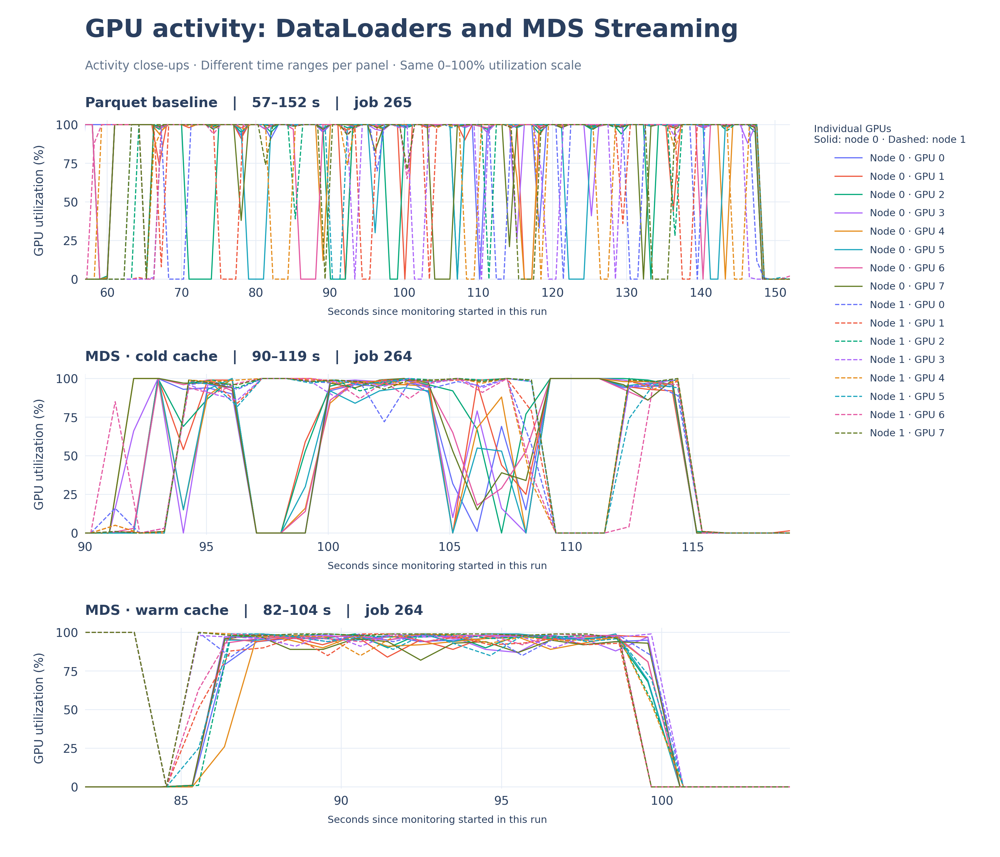

# Data Streaming for Distributed Training: Keep GPUs Fully Utilized


This repository contains the walkthrough code for the Data Streaming blog at [verda.com/blog](verda.com/blog). Follow along to run your own benchmarks to test whether data streaming from object storage to local NVMe cache can improve GPU utilization during training runs.

The experiment compares two input pipelines for distributed image classification training on Verda Instant Clusters.

* PyTorch DataLoader baseline: reads image samples from Parquet files in Verda object storage.
* MosaicML Streaming: reads the same dataset converted to the Mosaic Data Shard (MDS) format. The shards are uploaded to Verda Object Storage and use a node-local cache during training.

### The training job

We train a ResNet-18 image classifier on the [iNaturalist](https://www.kaggle.com/competitions/inaturalist-2021) 2021 mini training dataset of 500,000 images representing 10,000 classes. The benchmark runs training steps, including forward pass, loss calculation, backpropagation and optimizer update. The training steps are to measure system performance rather than train a model to convergence.

PyTorch DistributedDataParallel (DDP) runs one training process per GPU. Slurm allocates the nodes, and `torchrun` launches the distributed processes. Each run includes warmup steps followed by a measured training window.

### Hardware and configuration

The experiments run on a Verda [Instant Cluster] (https://verda.com/blog/instant-clusters-h1-2026) with a Slinky environment, which offers a preconfigured Slurm environment on top of Kubernetes.

Our cluster comprises two nodes of 8 x NVIDIA B300 GPUs each. The experiment can be adapted to fit different clusters with a few configuration changes.

| Setting | Configuration |
|---|---|
| Worker nodes | 2 |
| GPUs per node | 8 × NVIDIA B300 |
| GPUs used | 16 |
| Model | ResNet-18 |
| Precision | FP32 |
| Batch size per GPU | 64 |
| Global batch size | 1,024 |
| DataLoader workers per GPU | 4 |
| Measured training steps | 200 |
| Measured sample presentations | 204,800 |
| Remote storage | Verda object storage, accessed through its S3-compatible API |
| MDS cache | Node-local storage |

### Three runs for comparison

We measure: 
* PyTorch DataLoader baseline, feeding GPUs data samples from Parquet files.
* Cold cache data streaming. The run using MDS starts with an empty application cache on each worker node. Shards are fetched from object storage and cached locally. 
* Warm cache data streaming. The training runs again on the same nodes, and this time, previously downloaded shards can be reused. Run both the cold and warm phases inside the same Slurm allocation to preserve access to the same node-local caches.

### Repository layout 

* data_prep/   Download, upload, and MDS conversion scripts
* training/    Parquet and MDS training benchmarks
* slurm/       Slurm job scripts
* analysis/    GPU utilization plotting code
* results/     Selected logs, configurations, and plots
* docs/        Additional experiment notes

## Run the experiments

### Environment

This example is based on access to a Slurm cluster with NVIDIA GPUs and S3-compatible object storage.

Clone this repository, then from the repository root:

```
python -m venv venv
source venv/bin/activate
pip install -r requirements.txt
```
### Configure object storage

To learn more about and set up Verda Object Storage, please see the [documentation](https://docs.verda.com/storage/object-storage/).
```
export VERDA_S3_ENDPOINT="https://YOUR_OBJECT_STORAGE_ENDPOINT"
export VERDA_S3_BUCKET="YOUR_BUCKET"
export VERDA_S3_ACCESS_KEY="YOUR_ACCESS_KEY"
export VERDA_S3_SECRET_KEY="YOUR_SECRET_KEY"

export DATA_PREFIX="inaturalist/data"
export DATA_MDS_PREFIX="inaturalist_mds_v1"
```

### Prepare the dataset

`python data_prep/download_inaturalist.py`
There should now be an `inaturalist` folder in the root directory.

`python3 data_prep/upload_data.py ./downloads/inaturalist \ --prefix inaturalist`

`export DATA_PREFIX="inaturalist/data"` # change folder path as appropriate

`python data_prep/convert_to_mds.py`

This makes us ready for both Parquet file and MDS shard training. 

### Configure Slurm jobs

For the mentioned configuration, we allocate eight GPUs across each of two nodes. Check the Slurm scripts for:
* Node and GPU counts
* Python environment and repository paths
* Dataset prefixes and object storage paths
* A node-local, writable MDS cache directory 
* CPU allocation sufficient for the configured DataLoader workers

### Submit jobs

From the repository root:

```
sbatch slurm/baseline.sbatch
sbatch slurm/mds.sbatch
```

The MDS job should execute both cold and warm phases within one allocation. To follow the logs, check the job ID Slurm prints:

`tail -f baseline-<JOB_ID>.out`

### Running with fewer GPUs

For a single eight-GPU node, change the Slurm node count to one and keep eight processes per node. Reduce the GPU allocation and `torchrun` process count for smaller allocations. 

## Measurements

| Metric | Description |
|---|---|
| Global throughput | Sample presentations processed per second during the measured window |
| Measured wall time | Time taken to complete the measured training steps |
| Time to first batch | Startup delay to the first batch |
| Input wait | Time spent waiting for the next DataLoader batch|
| Training-step time | Training work, including distributed communication |
| GPU utilization | GPU activity sampled approximately once per second using nvidia-smi |

It's worth noting input-wait fraction doesn't represent a percentage of GPU idleness. Similarly, high GPU utliziation doesn't necessarily mean productive model computation; distributed communication can also register as accelerator activity.

## Sample results

On the cluster mentioned above, the experiments yielded the following results:

| Metric | Parquet baseline | MDS cold cache | MDS warm cache |
|---|---:|---:|---:|
| Measured sample presentations | 204,800 | 204,800 | 204,800 |
| Measured wall time | 77.63 s | 20.54 s | 12.95 s |
| Global throughput | 2,638.1 images/s | 9,970.7 images/s | 15,809.0 images/s |
| Max rank time to first batch | 29.75 s | 57.21 s | 55.34 s |
| Mean input wait | 27.1 ms | 19.6 ms | 0.4 ms |
| Median input wait | 0.3 ms | 0.3 ms | 0.3 ms |
| P95 input wait | 2.4 ms | 33.9 ms | 1.0 ms |
| Mean train time per step | 361.1 ms | 83.1 ms | 64.3 ms |
| Mean total step time | 388.2 ms | 102.7 ms | 64.7 ms |
| Input-wait fraction | 7.0% | 19.1% | 0.7% |


